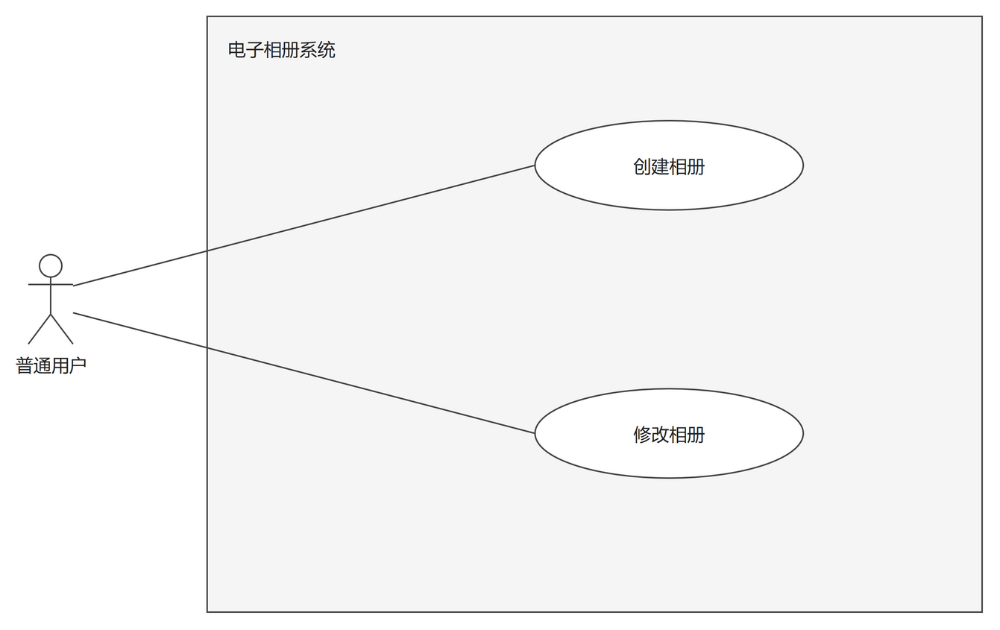
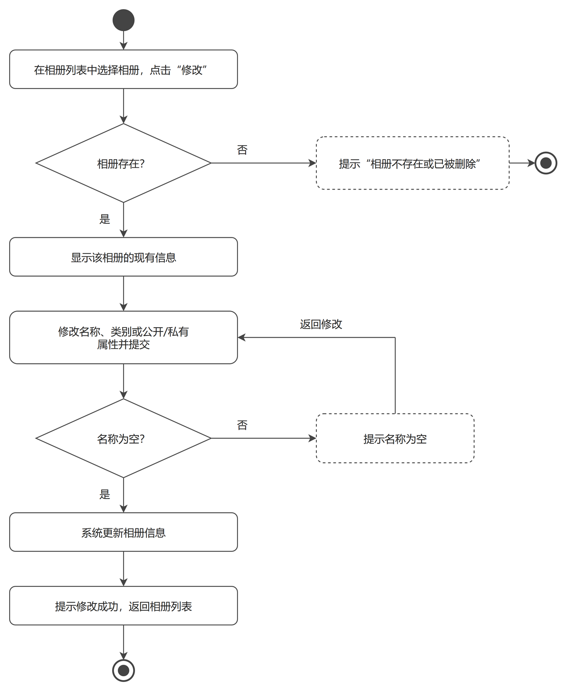
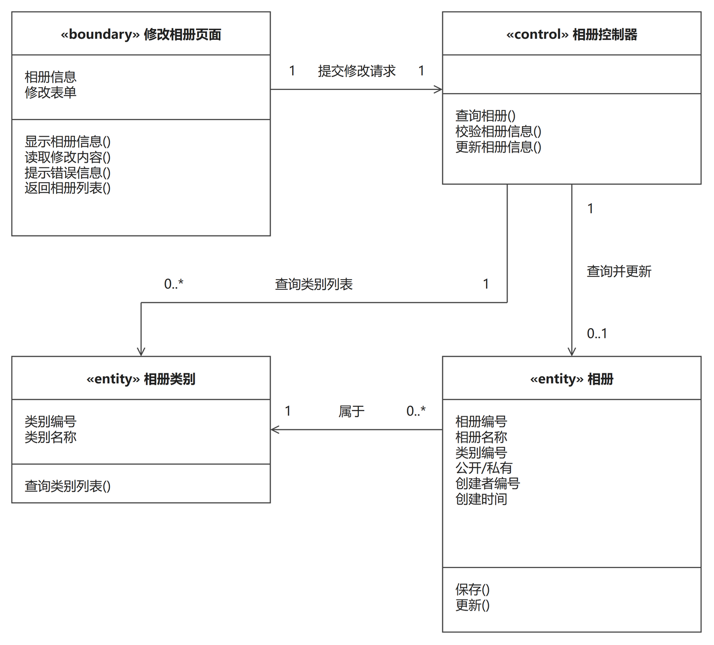
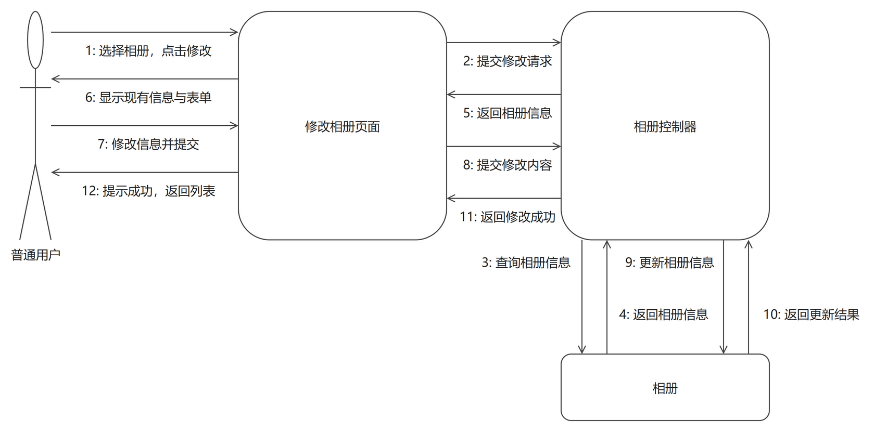

# 修改相册（成员C · 刘硕 · 相册管理模块）

> 本文件是「修改相册」用例的完整交付：功能描述（用例描述 + 模块用例图 + 活动图）+ 逻辑分析与建模（类模型图 + 协作图）。
> 同模块的「创建相册」用例见 `创建相册.md`，两个用例共用同一张模块用例图。
> 用例描述与 `docs/需求分析/02_用例描述初稿.md` 用例 4 口径一致，未做改动。

## 一、功能描述

### 1. 用例描述

- **用例名称**：修改相册
- **参与者**：普通用户（相册所有者）
- **前置条件**：用户已登录，相册已存在
- **基本流程**：
  1. 用户在相册列表中选择相册，点击"修改"；
  2. 系统显示该相册的现有信息；
  3. 用户修改相册名称、类别或公开/私有属性并提交；
  4. 系统校验；
  5. 系统更新相册信息；
  6. 提示修改成功，返回相册列表。
- **扩展流程**：
  - 4a. 名称为空，系统提示错误，返回步骤 3；
  - 1a. 相册不存在或已被删除，系统提示，返回相册列表。
- **后置条件**：相册信息被更新（如私有改公开后，其他用户可浏览）。

### 2. 用例图

**图说明**：与「创建相册」共用同一张模块用例图。大矩形为系统边界（电子相册系统），内部两个椭圆是"创建相册""修改相册"，参与者"普通用户"与两个用例分别用无箭头实线相连。"修改相册"的参与者特别标注为相册所有者：只有相册本人才可以修改，这一点写在本用例的前置条件和协作图的参与者标注里；图面上两个用例同属一个参与者，因此不需要拆出新的参与者。"相册类别管理"（管理员）属于模块 4 的用例图，不在本图重复出现。

### 3. 活动图

**图说明**：主流程自上而下走一列：在相册列表中选择相册并点击"修改" → 显示该相册的现有信息 → 修改名称、类别或公开/私有属性并提交 → 校验 → 更新相册信息 → 提示修改成功，返回相册列表 → 结束。两个扩展流程都画成菱形分支：扩展流程 1a 位于流程最前面，判断"相册存在？"为"否"时进入虚线框"提示'相册不存在或已被删除'"，随后按用例描述"返回相册列表"，用一个就近的活动终点结束这条支路（与主流程的终点区分开，UML 允许多个活动终点）；扩展流程 4a 位于提交之后，判断"名称为空？"为"否"时进入虚线框"提示名称为空"，随后回路拐回步骤 3"修改名称、类别或公开/私有属性并提交"。虚线框按绘图规范表示"扩展/可选"内容，四条分支标签（两个"是"、两个"否"、一处回路名）都紧贴各自线段，不与框线和文字重叠。

## 二、逻辑分析与建模

### 1. 类模型图

**图说明**：与「创建相册」同构，仍按 BCE 分三类，但按本用例的动作替换了名称与方法：边界类"修改相册页面"（属性：相册信息、修改表单；方法：显示相册信息()、读取修改内容()、提示错误信息()、返回相册列表()），控制类"相册控制器"（方法：查询相册()、校验相册信息()、更新相册信息()），实体类"相册"（属性：相册编号、相册名称、类别编号、公开/私有、创建者编号、创建时间；方法：保存()、更新()），实体类"相册类别"（属性：类别编号、类别名称；方法：查询类别列表()）。类框为三栏矩形拼接，栏间是共享黑边框；"相册控制器"不保存数据，属性栏留空。关联四条，文字统一放在线的同一侧：①页面 → 控制器"提交修改请求"，1:1；②控制器 → 相册"查询并更新"，相册端为 0..1——相册可能已被删除或不存在（对应扩展流程 1a），查询结果允许为空；③控制器 → 相册类别"查询类别列表"，相册类别端 0..*，修改类别时读取有效类别；④相册 → 相册类别"属于"，相册端 0..*、相册类别端 1。与创建用例的差别集中在②的多重性：创建时相册必然生成（1），修改时相册可能查不到（0..1）。

### 2. 协作图

**图说明**：协作图展示参与者"普通用户"与三个对象（修改相册页面、相册控制器、相册）之间的消息往来，共 12 条消息，编号即执行顺序，与用例基本流程一一对应：1 用户在相册列表中选择相册、点击"修改"（流程第 1 步）→ 2 页面把修改请求提交给控制器 → 3 控制器向相册对象查询、4 返回相册信息（第 2 步）→ 5 控制器把现有信息返回页面 → 6 页面显示现有信息与修改表单（第 2 步）→ 7 用户修改名称、类别或公开/私有属性并提交（第 3 步）→ 8 页面把修改内容提交给控制器 → 9 控制器更新相册信息（第 5 步）→ 10 返回更新结果 → 11 控制器返回修改成功（第 6 步）→ 12 页面提示修改成功并返回相册列表（第 6 步）。对象框内不写冒号；每对对象之间的双向消息画成两条平行线、各自带箭头，编号标签紧贴所属线段。两个扩展流程在消息序列中的体现：扩展流程 4a——校验发现"名称为空"时消息 9、10 不发生，控制器改为把错误信息返回页面（消息 11 语义变为"返回错误信息"），页面提示错误并停留在修改表单页（消息 12 语义变为"提示错误并停留"），即活动图中的回路；扩展流程 1a——消息 3、4 返回"相册不存在或已被删除"时，消息 5 直接变为"返回错误提示"，消息 6–12 不发生，页面提示后返回相册列表。修改类别时控制器对类别字典的读取（控制器 ↔ 相册类别）与「创建相册」一致，为避免图面重复拥挤，只在类模型图中画出该关联。

---

## 提交前自查（本用例）

- [x] 用例描述六段式齐全，与 `02_用例描述初稿.md` 用例 4 口径一致
- [x] 活动图覆盖扩展流程 1a、4a，错误分支分别就近结束与形成回路（拐回步骤 3）
- [x] 模块用例图 1 张（两个用例共用），活动图 1 张
- [x] 类模型图为三栏式矩形拼接（类名/属性/方法，无灰色分隔线），关联带箭头与多重性（相册端 0..1 对应扩展流程 1a），同一关联线上的文字统一在线的同侧
- [x] 协作图对象框内不带冒号；消息按执行顺序编号（1–12）且与基本流程对应；双向消息画成两条平行带箭头线，编号标签紧贴所属线段
- [x] 每幅图后均有文字说明
- [x] PNG 已逐张目检：无穿框、无压字、文字完整；`.drawio` 源文件已一并提交
