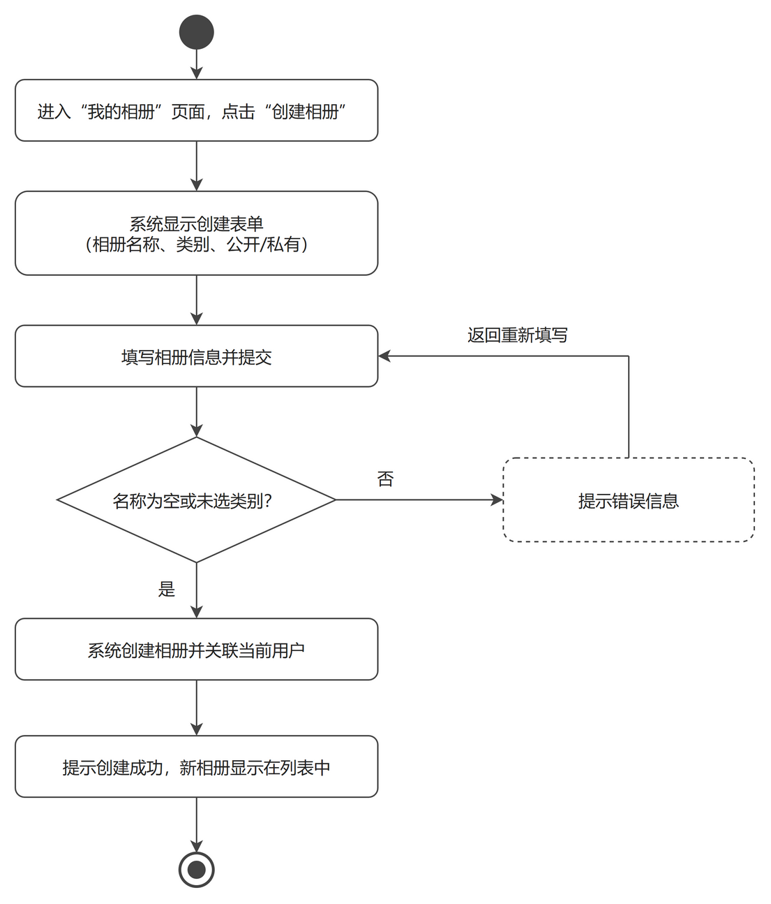
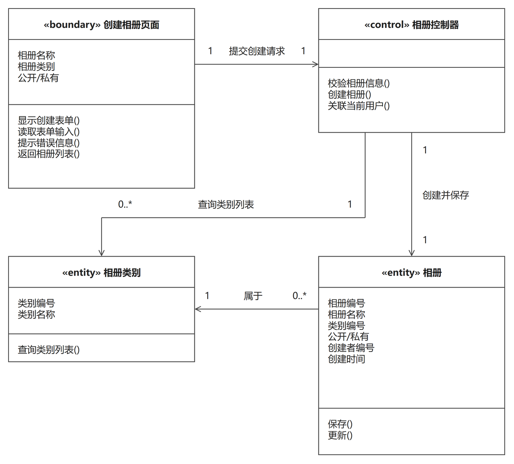
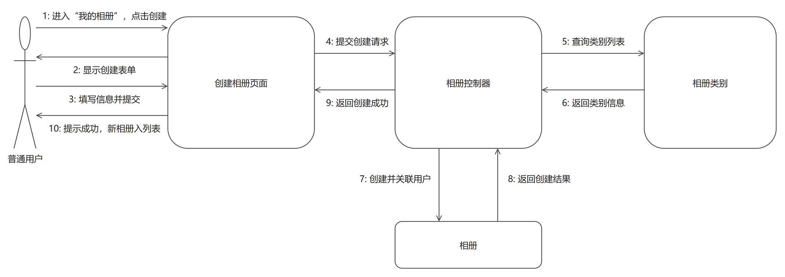

# 创建相册（成员C · 刘硕 · 相册管理模块）

> 本文件是「创建相册」用例的完整交付：功能描述（用例描述 + 模块用例图 + 活动图）+ 逻辑分析与建模（类模型图 + 协作图）。
> 同模块的「修改相册」用例见 `修改相册.md`，两个用例共用同一张模块用例图。
> 用例描述与 `docs/需求分析/02_用例描述初稿.md` 用例 3 口径一致，未做改动。

## 一、功能描述

### 1. 用例描述

- **用例名称**：创建相册
- **参与者**：普通用户
- **前置条件**：用户已登录
- **基本流程**：
  1. 用户进入"我的相册"页面，点击"创建相册"；
  2. 系统显示创建表单：相册名称、相册类别（系统类别列表）、公开/私有设置；
  3. 用户填写信息并提交；
  4. 系统校验（名称非空、类别已选）；
  5. 系统创建相册，并关联到当前用户；
  6. 提示创建成功，返回相册列表，新相册出现在列表中。
- **扩展流程**：
  - 4a. 相册名称为空或未选类别，系统提示错误，返回步骤 3。
- **后置条件**：系统中新增一个属于当前用户的相册。

### 2. 用例图

**图说明**：大矩形是系统边界（电子相册系统），内部两个椭圆是本模块（用户侧）的两个用例"创建相册""修改相册"，两者共用这一张模块用例图。参与者"普通用户"分别与两个用例用无箭头实线相连，表示参与关系——两个用例都以普通用户为唯一参与者，且都以"已登录"为前置条件。本模块的用户侧用例图不画"相册类别管理"：该用例的参与者是管理员，属于管理员端功能，已在模块 4（类别与评论）的用例图中单独画出，这里重复画会让模块边界混乱、也会让"普通用户"错误地连到管理员用例上。

### 3. 活动图

**图说明**：主流程自上而下走一列：进入"我的相册"页面并点击"创建相册" → 系统显示创建表单（相册名称、类别、公开/私有）→ 填写信息并提交 → 校验 → 创建相册并关联当前用户 → 提示成功，新相册显示在列表中 → 结束。用例基本流程第 4 步"系统校验"在图中表现为菱形判断"名称为空或未选类别？"，因为校验本身不产生用户可见动作，判断结果才是分支依据。扩展流程 4a 画成右侧分支：判断为"否"（即名称不为空且已选类别 → 校验不通过）时进入虚线框"提示错误信息"，随后回路拐回步骤 3"填写相册信息并提交"，与用例描述中"返回步骤 3"一一对应；判断为"是"（校验通过）时继续主流程创建相册。虚线框按绘图规范表示"扩展/可选"内容。

## 二、逻辑分析与建模

### 1. 类模型图

**图说明**：按边界/控制/实体（BCE）从用例描述中提取分析类：名词"创建表单、相册名称、类别、公开/私有"落到边界类"创建相册页面"，动词"校验、创建、关联"落到控制类"相册控制器"，名词"相册、类别"落到实体类"相册""相册类别"。类框为三栏矩形拼接：第一栏类名（带 «boundary»/«control»/«entity» 版型），第二栏属性，第三栏方法，栏间为共享黑边框；"相册控制器"只做协调、不保存数据，属性栏留空。关联关系四条，文字（关联名 + 两端多重性）统一放在线的同一侧（水平线在上方、垂直线在右方）：①"创建相册页面 → 相册控制器"，关联名"提交创建请求"，两端均为 1，因为每次创建由页面提交一次请求；②"相册控制器 → 相册"，关联名"创建并保存"，两端均为 1，因为校验通过后必然生成一个相册对象；③"相册控制器 → 相册类别"，关联名"查询类别列表"，相册类别端为 0..*，因为类别字典可由管理员维护成空表或多个类别，控制器按需读取（用例基本流程第 2 步的"系统类别列表"）；④"相册 → 相册类别"，关联名"属于"，相册端 0..*、相册类别端 1，表示一个类别下可挂多个相册，一个相册只属于一个类别。"相册类别"是只读使用——它的维护由管理员端的"相册类别管理"用例负责，本用例不定义对类别的新增/修改/删除操作，因此该类的操作只有"查询类别列表()"，避免与模块 4 的模型重复定义。

### 2. 协作图

**图说明**：协作图展示参与者与四个对象（创建相册页面、相册控制器、相册类别、相册）之间的消息往来，共 10 条消息，编号即执行顺序，与用例基本流程对应：1 用户进入"我的相册"并点击创建（流程第 1 步）→ 2 页面显示创建表单（第 2 步）→ 3 用户填写信息并提交（第 3 步）→ 4 页面把创建请求提交给控制器 → 5 控制器向相册类别查询类别列表、6 返回类别信息（第 2 步的"系统类别列表"）→ 7 控制器创建相册并关联当前用户（第 5 步）→ 8 返回创建结果 → 9 控制器返回创建成功（第 6 步）→ 10 页面提示创建成功并把新相册加入列表（第 6 步）。对象框内不写冒号（写"创建相册页面"，不写":创建相册页面"）；每对对象之间的双向消息画成两条平行线、各自带箭头，编号标签紧贴所属线段，方向与编号一眼对应。扩展流程 4a 的体现：控制器校验时若发现"名称为空或未选类别"，消息 7、8 不发生，控制器改为把错误信息返回页面，页面提示错误并停留在创建表单页（此时消息 9、10 的语义变为"返回错误信息""提示错误并停留"），与活动图右侧的回路一致。

---

## 提交前自查（本用例）

- [x] 用例描述六段式齐全，与 `02_用例描述初稿.md` 用例 3 口径一致
- [x] 活动图覆盖扩展流程 4a，错误分支形成回路（拐回步骤 3）
- [x] 模块用例图 1 张（两个用例共用），活动图 1 张
- [x] 类模型图为三栏式矩形拼接（类名/属性/方法，无灰色分隔线），关联带箭头与多重性，同一关联线上的文字统一在线的同侧
- [x] 协作图对象框内不带冒号；消息按执行顺序编号（1–10）且与基本流程对应；双向消息画成两条平行带箭头线，编号标签紧贴所属线段
- [x] 每幅图后均有文字说明
- [x] PNG 已逐张目检：无穿框、无压字、文字完整；`.drawio` 源文件已一并提交
