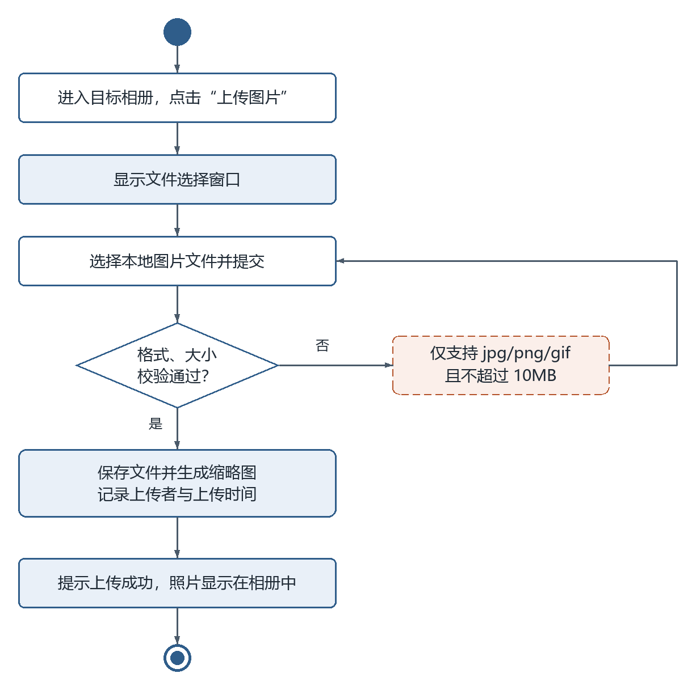
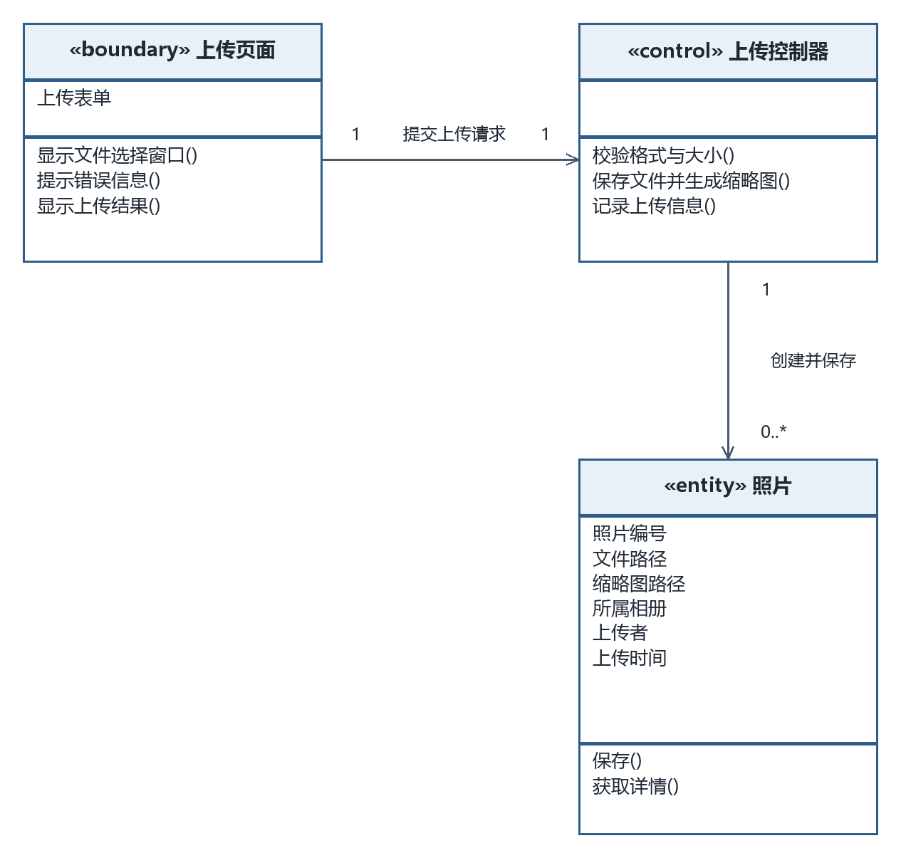
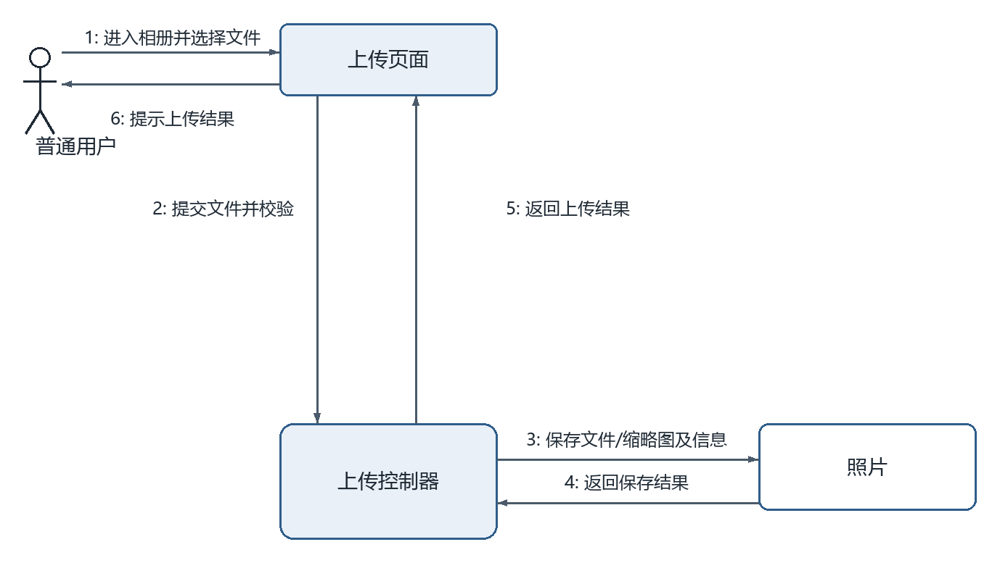

# 上传图片（成员 D · 照片管理模块）

> 本文件是单个功能用例的完整交付：功能描述（用例 + 用例图 + 活动图）+ 逻辑分析与建模（类模型图 + 协作图）。
> 同模块的「浏览照片」用例见 `浏览照片.md`，两个用例共用同一张模块用例图。

## 一、功能描述

### 1. 用例描述

- **用例名称**：上传图片
- **参与者**：普通用户
- **前置条件**：用户已登录，目标相册已存在
- **基本流程**：
  1. 用户进入目标相册，点击"上传图片"；
  2. 系统显示文件选择窗口；
  3. 用户选择本地图片文件并提交；
  4. 系统校验文件格式（jpg/png/gif）和大小（不超过 10MB）；
  5. 校验通过，系统保存图片文件并生成缩略图，记录上传者和上传时间；
  6. 提示上传成功，照片显示在相册中。
- **扩展流程**：
  - 4a. 格式或大小不符合要求，系统提示"仅支持 jpg/png/gif，且不超过 10MB"，返回步骤 3。
- **后置条件**：相册中新增一张照片（记录上传者、所属相册、上传时间）。

（与 `docs/需求分析/02_用例描述初稿.md` 用例 6 口径一致，未做改动。）

### 2. 用例图

**图说明**：普通用户参与上传图片、浏览照片两个用例。两个椭圆位于电子相册系统边界内，参与关系使用无箭头实线。

### 3. 活动图

**图说明**：进入相册并打开文件选择窗口，用户选择图片提交，系统检查 jpg/png/gif 格式及不超过 10MB 的大小限制。校验通过后保存文件、生成缩略图并记录上传者和时间；不通过时提示限制并返回选择文件，覆盖扩展流程 4a。

## 二、逻辑分析与建模

### 1. 类模型图

**图说明**：上传页面负责选择文件和提示，上传控制器校验文件、协调文件保存与缩略图生成并记录信息，照片实体保存路径与元数据。照片字段与浏览、评论用例统一，包括照片编号、文件路径、缩略图路径、所属相册、上传者、上传时间。控制器可处理多次上传，因此照片端为 0..*；单次上传新增一张照片。

### 2. 协作图

**图说明**：消息 1–6 表示进入相册并选择文件、提交并校验、保存文件与缩略图及上传信息、返回保存结果、返回上传结果、提示结果。文件选择窗口包含在页面与用户的交互中。校验不通过时跳过保存，由页面提示限制并返回文件选择。

---

## 提交前自查（本用例）

- [x] 用例描述六段式齐全，与 02 初稿口径一致
- [x] 活动图覆盖扩展流程 4a，错误分支形成回路
- [x] 类模型图为三栏式（类名/属性/方法），关联带箭头与多重性
- [x] 协作图消息按执行顺序编号（1–6），与基本流程对应
- [x] 每幅图后均有文字说明
- [x] PNG 已目检：无穿框、无压字、文字完整；`.drawio` 源文件已一并提交
