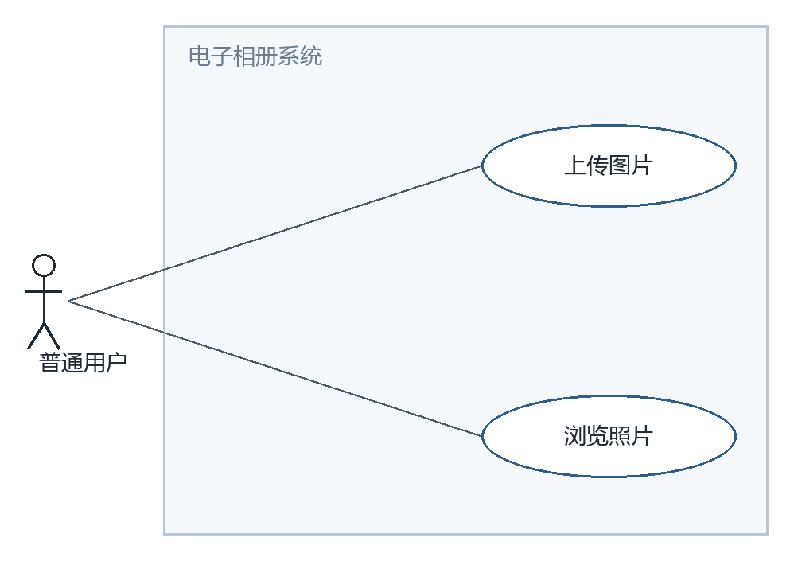
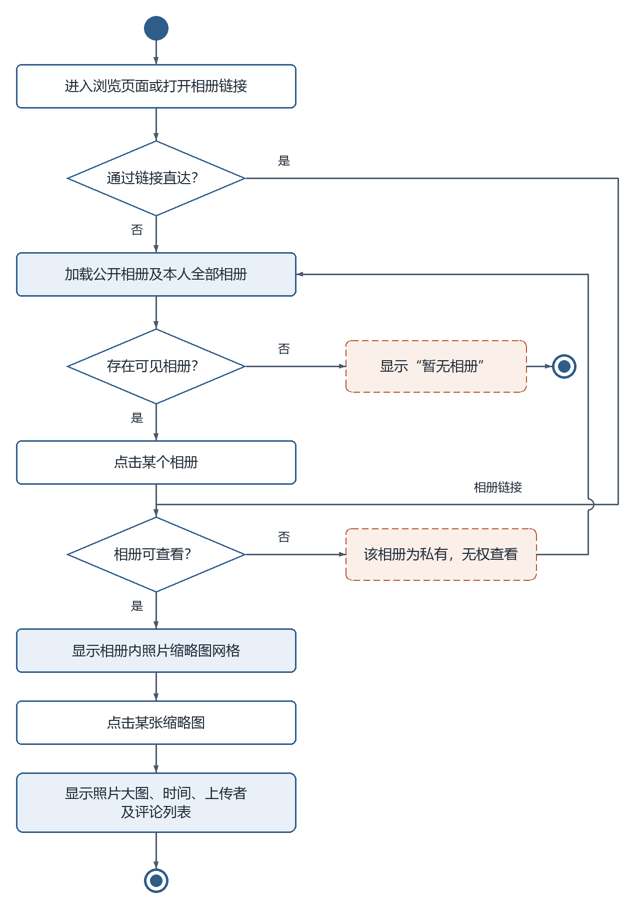
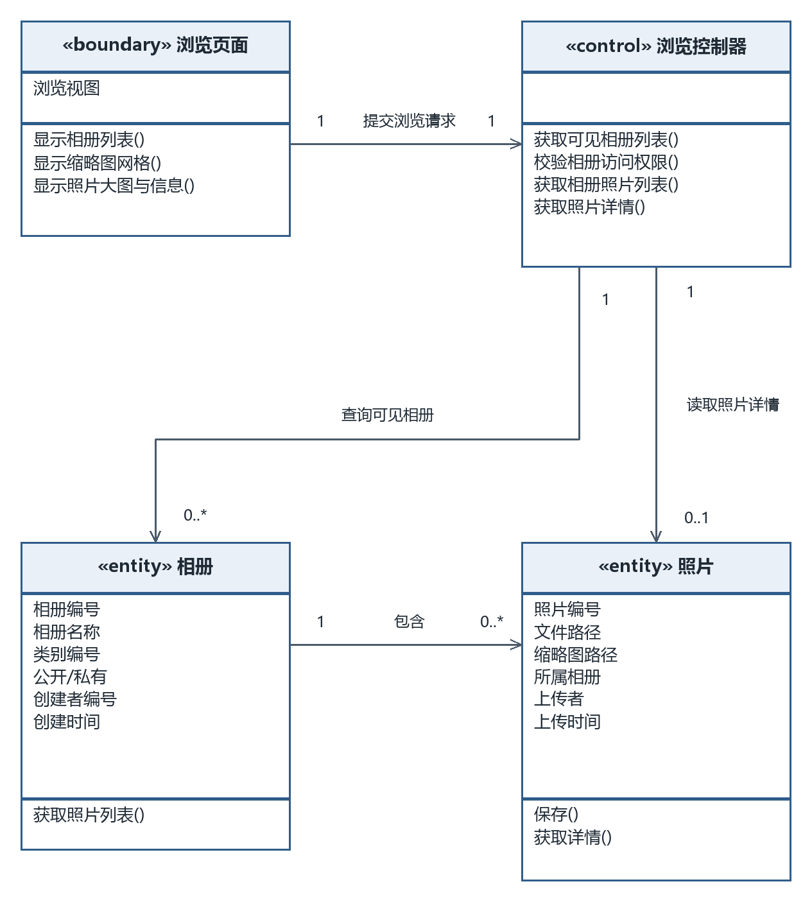
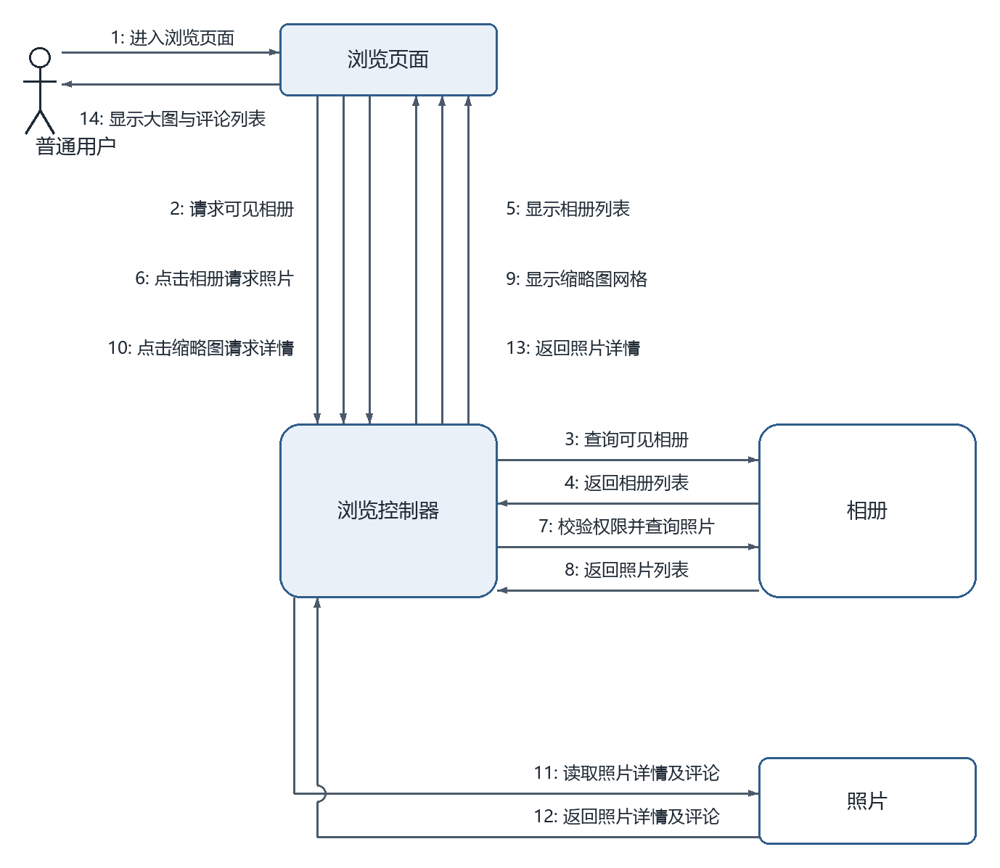

# 浏览照片（成员 D · 照片管理模块）

> 本文件是单个功能用例的完整交付：功能描述（用例 + 用例图 + 活动图）+ 逻辑分析与建模（类模型图 + 协作图）。
> 同模块的「上传图片」用例见 `上传图片.md`，两个用例共用同一张模块用例图。

## 一、功能描述

### 1. 用例描述

- **用例名称**：浏览照片
- **参与者**：普通用户
- **前置条件**：用户已登录
- **基本流程**：
  1. 用户进入浏览页面，系统显示所有公开相册列表（含本人的全部相册）；
  2. 用户点击某个相册；
  3. 系统显示该相册内照片的缩略图网格；
  4. 用户点击某张缩略图；
  5. 系统显示照片大图及照片信息（拍摄/上传时间、上传者、评论列表）。
- **扩展流程**：
  - 1a. 不存在任何可见相册，系统显示"暂无相册"；
  - 2a/链接直达：若用户访问他人私有相册，系统提示"该相册为私有，无权查看"，返回步骤 1。
- **后置条件**：无（只读操作，不改变系统状态）。

（与 `docs/需求分析/02_用例描述初稿.md` 用例 7 口径一致，未做改动。）

### 2. 用例图

**图说明**：普通用户参与浏览照片和上传图片。可浏览范围为公开相册及本人全部相册；此图仅表示参与关系，具体可见性规则由活动图和控制器表达。

### 3. 活动图

**图说明**：正常入口先加载公开相册与本人全部相册，无可见相册时提示“暂无相册”并结束；存在时选择相册。链接直达入口绕过列表选择，但与正常入口汇入同一个“相册可查看？”判断。访问他人私有相册时提示无权查看并返回加载列表；允许访问才显示缩略图，点击后展示大图、时间、上传者和评论列表。

## 二、逻辑分析与建模

### 1. 类模型图

**图说明**：浏览页面展示列表、网格及详情，浏览控制器查询并校验访问权限。相册、照片使用跨用例统一字段。控制器可查询零到多个可见相册，读取单张照片详情的多重性为 0..1；一个相册可包含零到多张照片，包含关系的两端为 1 和 0..*。

### 2. 协作图

**图说明**：消息 1–14 分三段：1–5 进入并查询、显示可见相册列表；6–9 点击相册、校验权限并读取照片、显示缩略图；10–14 点击缩略图、读取照片详情及评论并显示大图。可见相册列表为空时提示并停止后续消息；私有相册访问被拒绝时不读取照片，返回列表。链接直达从相册访问请求进入，同样执行权限校验。

---

## 提交前自查（本用例）

- [x] 用例描述六段式齐全，与 02 初稿口径一致
- [x] 活动图覆盖扩展流程 1a、2a，错误分支形成回路或直达结束
- [x] 类模型图为三栏式（类名/属性/方法），关联带箭头与多重性
- [x] 协作图消息按执行顺序编号（1–14），与基本流程对应
- [x] 每幅图后均有文字说明
- [x] PNG 已目检：无穿框、无压字、文字完整；`.drawio` 源文件已一并提交
