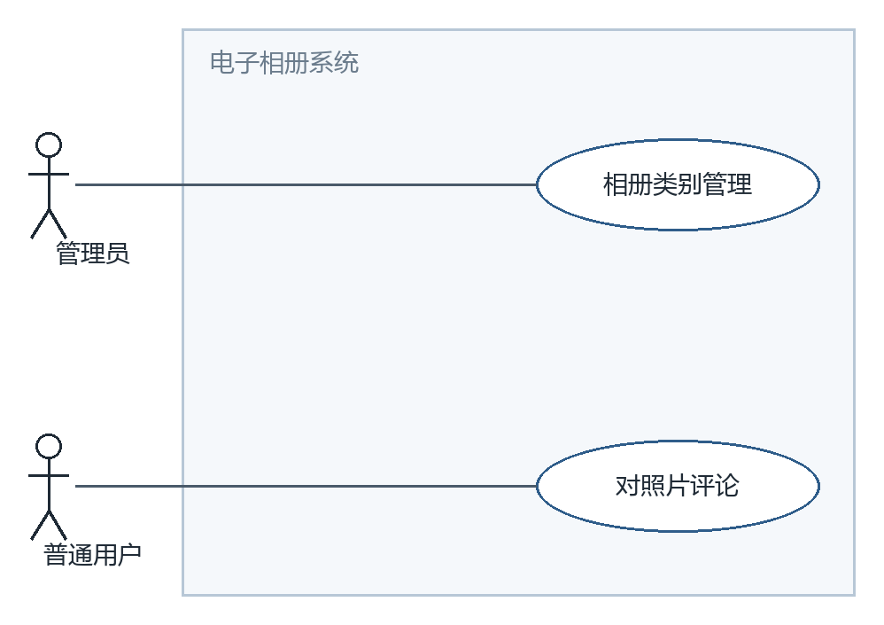
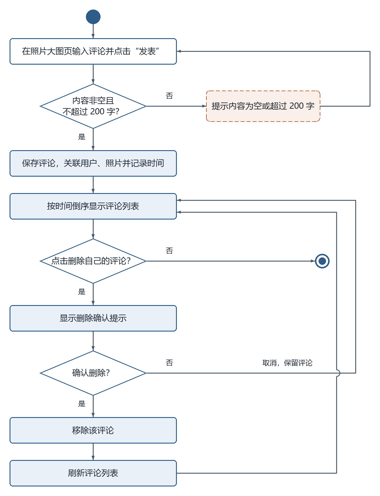
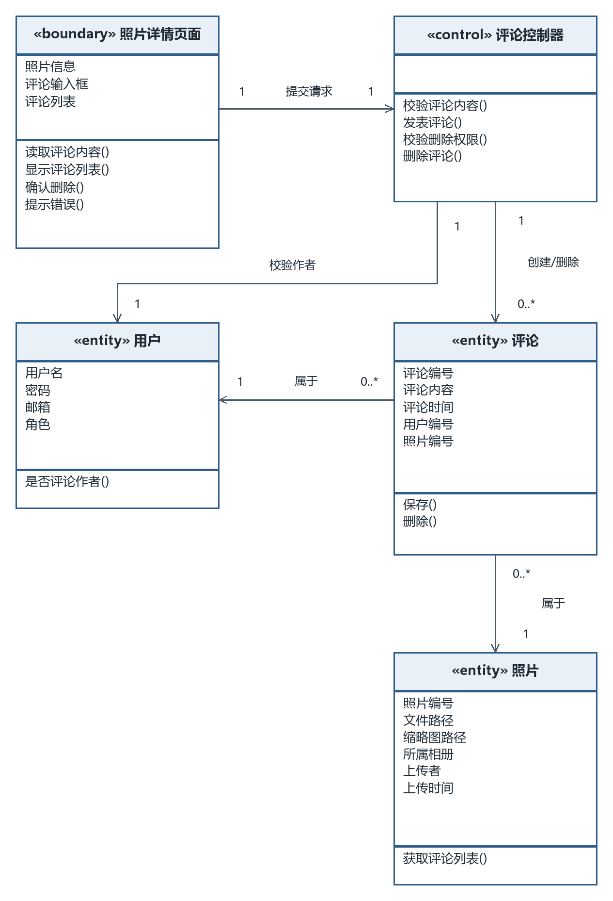
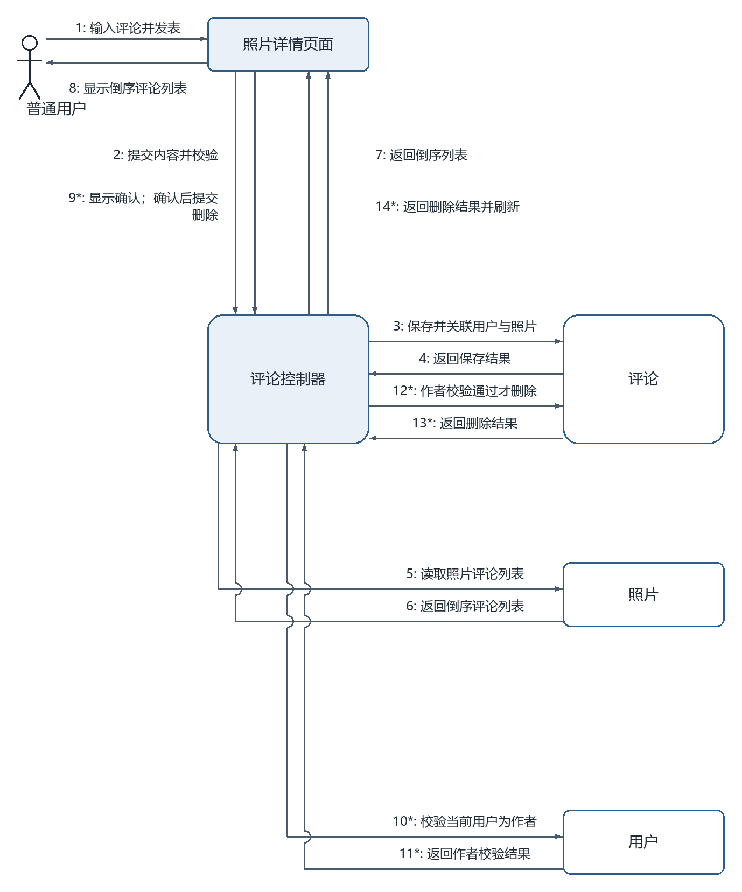

# 对照片评论

## 一、功能描述

### 1. 用例描述

- **用例名称**：对照片评论
- **参与者**：普通用户
- **前置条件**：用户已登录，照片对其可见（公开相册中的照片或本人相册中的照片）。
- **基本流程**：
  1. 用户在照片大图页输入评论内容，点击“发表”；
  2. 系统校验评论内容非空且不超过 200 字；
  3. 系统保存评论，关联评论用户与照片，并记录评论时间；
  4. 评论按时间倒序显示在照片下方的评论列表中。
- **扩展流程**：
  - 2a. 内容为空或超过 200 字，系统提示错误并返回步骤 1；
  - 4a. 用户对自己发表的评论点击“删除”，系统显示确认提示，用户确认后移除该评论并刷新列表；若取消则保留评论并返回列表。
- **后置条件**：照片新增一条评论记录；执行删除扩展流程时，相应评论记录被移除。

（与 `docs/需求分析/02_用例描述初稿.md` 用例 8 口径一致；为便于活动图建模，明确了输入错误、取消删除后的返回位置。）

### 2. 用例图

**图说明**：本用例与相册类别管理共用模块用例图。普通用户连接对照片评论，管理员连接相册类别管理；评论删除作为评论用例的扩展流程处理。

### 3. 活动图

**图说明**：输入评论后判断内容非空且不超过 200 字，不通过时提示并返回输入；通过时保存评论及关联信息，按时间倒序显示。用户选择删除自己的评论后显示确认，确认才移除并刷新；取消时保留评论并返回列表，不删除时结束本次活动。

## 二、逻辑分析与建模

### 1. 类模型图

**图说明**：照片详情页面负责输入、展示和删除确认；评论控制器负责内容校验、发布、作者校验和删除。评论记录用户编号和照片编号，每条评论属于一个用户和一张照片，用户与照片都可关联零到多条评论。用户、照片字段与其他用例一致，照片实体提供读取评论列表的方法。

### 2. 协作图

**图说明**：基本消息 1–8：输入并发表、提交校验、保存并关联用户和照片、返回保存结果、读取照片评论、返回倒序列表、返回页面、显示列表。带 * 的 9–14 为删除扩展：页面显示确认，用户确认后才提交删除；10–11 校验当前用户是否为作者；12–13 通过后删除并返回结果；14 返回结果并刷新。取消确认不提交删除请求，作者校验失败不执行删除；输入校验失败不保存评论。

## 提交前自查

- [x] 六段式用例描述齐全，与需求初稿口径一致
- [x] 活动图覆盖内容错误、删除确认与取消分支，错误流程形成回路
- [x] 类模型图采用三栏类框并标注关联与多重性
- [x] 协作图基本消息连续编号，删除扩展流程单独标明
- [x] 每幅图均配有文字说明，图片使用相对路径
