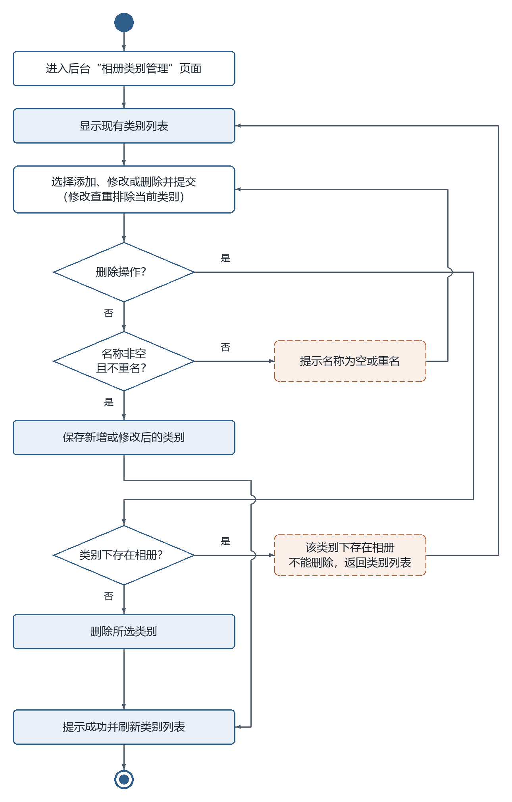
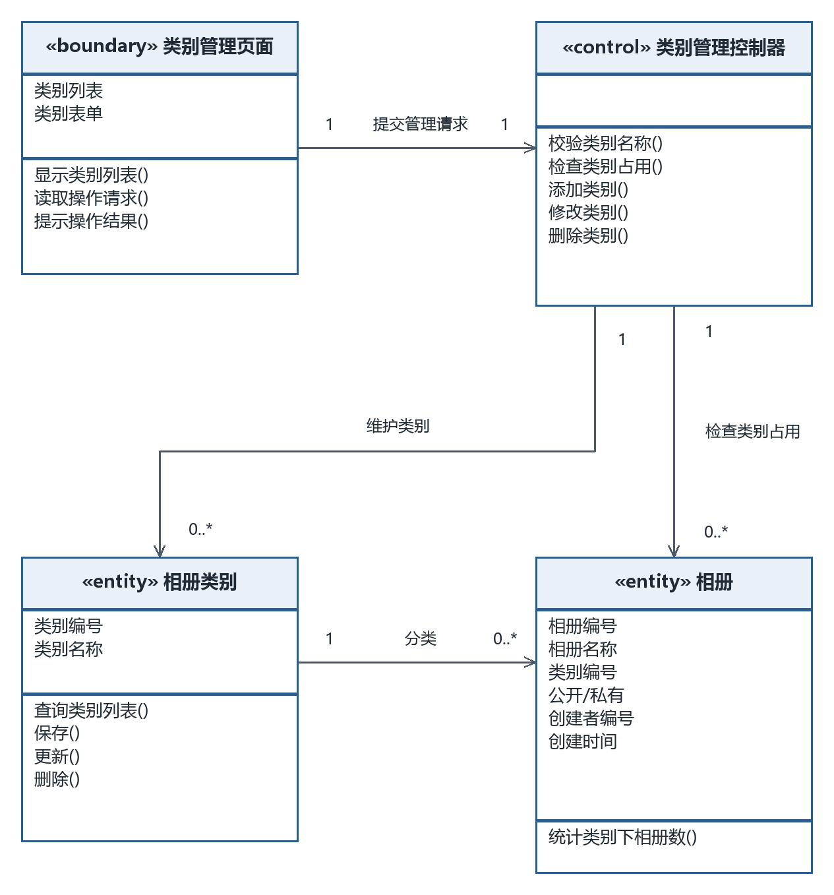
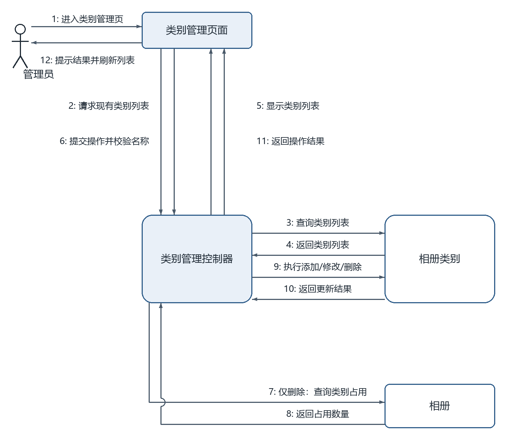

# 相册类别管理（管理员）

## 一、功能描述

### 1. 用例描述

- **用例名称**：相册类别管理
- **参与者**：管理员
- **前置条件**：管理员已登录并进入后台。
- **基本流程**：
  1. 管理员进入后台“相册类别管理”页面；
  2. 系统显示现有类别列表；
  3. 管理员执行添加、修改或删除类别操作并提交；
  4. 系统更新类别字典；
  5. 系统提示操作成功并刷新类别列表。
- **扩展流程**：
  - 3a. 新类别名称为空或与已有类别重名，系统提示错误并返回当前编辑操作；
  - 4a. 删除类别时，若该类别下仍存在相册，系统提示“该类别下存在相册，不能删除”，返回步骤 2。
- **后置条件**：类别字典更新，“创建相册”的可选类别随之变化。

（与 `docs/需求分析/02_用例描述初稿.md` 用例 5 口径一致；仅明确名称错误后的返回位置，未改变业务规则。）

### 2. 用例图

**图说明**：管理员参与相册类别管理，普通用户参与对照片评论。两类参与者各连接对应的用例，使用无箭头实线，不新增管理员专用登录用例。

### 3. 活动图

**图说明**：显示类别列表后提交添加、修改或删除操作。添加与修改共用名称校验分支，修改查重排除当前类别；名称为空或重名时提示并返回操作输入。删除分支绕过名称校验，先检查类别是否仍有相册：有则提示并返回列表，无则删除。保存或删除成功后统一提示并刷新列表，覆盖扩展流程 3a、4a。

## 二、逻辑分析与建模

### 1. 类模型图

**图说明**：类别管理页面为边界类，类别管理控制器负责名称校验、占用检查与增删改，相册类别及相册为实体类。实体字段与相册管理、浏览用例保持一致。一个类别可对应零到多个相册，控制器通过统计类别下的相册数决定能否删除，避免移除仍被引用的类别。

### 2. 协作图

**图说明**：消息 1–5 先加载并显示现有类别；6 提交操作，添加或修改时校验名称；7–8 仅在删除时查询相册占用并返回数量；9–10 执行类别更新并返回结果；11–12 返回操作结果、提示并刷新列表。名称不合法或占用数量大于零时不执行 9，页面提示错误并返回相应步骤。

## 提交前自查

- [x] 六段式用例描述齐全，与需求初稿口径一致
- [x] 活动图覆盖名称错误与类别占用两个扩展流程并形成返回回路
- [x] 类模型图采用三栏类框并标注关联与多重性
- [x] 协作图消息按执行顺序编号，双向消息使用平行箭头
- [x] 每幅图均配有文字说明，图片使用相对路径
