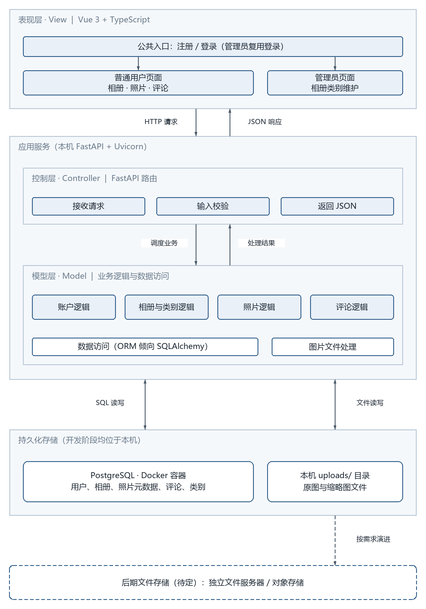
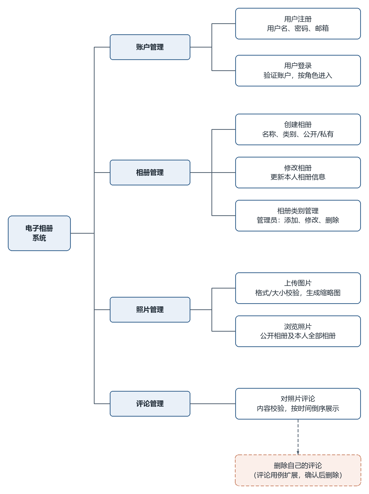

# 剩余图稿返修检查记录

日期：2026-10-21。依据 `docs/绘图规范.md` v2.1、账户管理模块 7 张样图及 `docs/需求分析/02_用例描述初稿.md`。

本轮范围为相册管理 7 张、照片管理 7 张、类别与评论 7 张、系统图 2 张，共 23 张。原账户管理样板与教学演示图未修改。所有图均从生成脚本重建，保留同名 `.drawio` 与 PNG。

## 先行逻辑核对与修正

| 项目 | 发现与处理 |
|---|---|
| 创建/修改相册活动图 | 名称为空、未选类别为“是”才提示错误；为“否”才保存。修改相册不存在时明确返回列表。 |
| 创建相册协作图 | 类别查询原在表单展示之后，现改为先请求并返回类别，再显示表单，随后提交创建。 |
| 浏览照片 | 原图没有独立画出链接直达入口；现与列表入口共用访问权限判断。他人私有相册拒绝，本人私有相册可见；无相册提示后结束。 |
| 类别管理 | 添加/修改共用名称校验，修改查重排除自身；删除先查相册占用，有占用返回列表，无占用才删除。 |
| 评论删除 | 原协作图没有完整删除请求与执行消息；现显示确认、确认后提交、校验作者、实际删除、刷新结果。取消确认不提交删除。 |
| 类模型图 | 浏览图单张详情查询为 0..1，与说明一致；相册包含照片为 1 对 0..*。三个模块内的同名实体统一字段，并保留评论对用户及照片的关联。 |
| 系统体系结构 | 补全 Controller 与 Model 的调用/返回；明确开发本机、Docker 数据库、文件系统存照片，ORM 仍为倾向方案；保留后期存储演进虚线。 |

修正后的活动分支、消息顺序、参与者与六个用例图后说明已逐项人工对照需求复核。上传文件限制仍为 jpg/png/gif、不超过 10MB；评论限制仍为非空、不超过 200 字；没有增加功能用例。

## 自动检查

执行 `python tools/check_figure_delivery.py`，检查 23 张图：

- 内容宽、满宽等效字号、活动/协作图宽高比；正文至少 8pt，标签至少 7pt。
- 参与者 30×60，显式连线端点，除用例参与线外均为正交折线。
- 连线不穿非容器框，独立标签不碰框、不相互重叠，文字高度不超过框高。
- 每幅协作图的消息编号连续；跨用例同名实体字段一致。
- 生成脚本重复运行后，23 个 `.drawio` 的 SHA-256 全部一致。

静态检查结果：23 张图，0 项失败。图义、分支含义及实际视觉由下节目检补充，不由静态检查自动证明。

## 逐图目检

全部 PNG 已逐张查看：核对文字、箭头方向、是/否标签、错误回路、交叉处小半圆桥及画面边缘。类别与评论图的多条回程线使用独立通道。最后将修改、浏览、评论活动图中的结束节点与邻近回流线拉开，避免误认为相连。

表中字号按正文满宽 439.4pt 的内容宽预算计算；类模型属性/方法按 13px，其余正文按 14px，标签按 12px。Word 整合时依规范插入宽度，不额外缩小。

| 图稿（点击看 PNG） | 内容宽 px | 正文 / 标签等效 pt | 目检 |
|---|---:|---:|---|
| [修改相册_协作图](../交付/2-相册管理-刘硕/images/修改相册_协作图.png) | 657.0 | 9.4 / 8.0 | 通过 |
| [修改相册_活动图](../交付/2-相册管理-刘硕/images/修改相册_活动图.png) | 581.0 | 10.6 / 9.1 | 通过 |
| [修改相册_类模型图](../交付/2-相册管理-刘硕/images/修改相册_类模型图.png) | 600.5 | 9.5 / 8.8 | 通过 |
| [创建相册_协作图](../交付/2-相册管理-刘硕/images/创建相册_协作图.png) | 657.0 | 9.4 / 8.0 | 通过 |
| [创建相册_活动图](../交付/2-相册管理-刘硕/images/创建相册_活动图.png) | 581.0 | 10.6 / 9.1 | 通过 |
| [创建相册_类模型图](../交付/2-相册管理-刘硕/images/创建相册_类模型图.png) | 600.5 | 9.5 / 8.8 | 通过 |
| [相册管理模块用例图](../交付/2-相册管理-刘硕/images/相册管理模块用例图.png) | 467.0 | 13.2 / 11.3 | 通过 |
| [上传图片_协作图](../交付/3-照片管理-王柯涵/images/上传图片_协作图.png) | 657.0 | 9.4 / 8.0 | 通过 |
| [上传图片_活动图](../交付/3-照片管理-王柯涵/images/上传图片_活动图.png) | 581.0 | 10.6 / 9.1 | 通过 |
| [上传图片_类模型图](../交付/3-照片管理-王柯涵/images/上传图片_类模型图.png) | 600.5 | 9.5 / 8.8 | 通过 |
| [浏览照片_协作图](../交付/3-照片管理-王柯涵/images/浏览照片_协作图.png) | 657.0 | 9.4 / 8.0 | 通过 |
| [浏览照片_活动图](../交付/3-照片管理-王柯涵/images/浏览照片_活动图.png) | 603.0 | 10.2 / 8.7 | 通过 |
| [浏览照片_类模型图](../交付/3-照片管理-王柯涵/images/浏览照片_类模型图.png) | 600.5 | 9.5 / 8.8 | 通过 |
| [照片管理模块用例图](../交付/3-照片管理-王柯涵/images/照片管理模块用例图.png) | 467.0 | 13.2 / 11.3 | 通过 |
| [对照片评论_协作图](../交付/4-类别与评论-陈诺/images/对照片评论_协作图.png) | 657.0 | 9.4 / 8.0 | 通过 |
| [对照片评论_活动图](../交付/4-类别与评论-陈诺/images/对照片评论_活动图.png) | 605.0 | 10.2 / 8.7 | 通过 |
| [对照片评论_类模型图](../交付/4-类别与评论-陈诺/images/对照片评论_类模型图.png) | 600.5 | 9.5 / 8.8 | 通过 |
| [相册类别管理_协作图](../交付/4-类别与评论-陈诺/images/相册类别管理_协作图.png) | 657.0 | 9.4 / 8.0 | 通过 |
| [相册类别管理_活动图](../交付/4-类别与评论-陈诺/images/相册类别管理_活动图.png) | 613.0 | 10.0 / 8.6 | 通过 |
| [相册类别管理_类模型图](../交付/4-类别与评论-陈诺/images/相册类别管理_类模型图.png) | 600.5 | 9.5 / 8.8 | 通过 |
| [类别与评论模块用例图](../交付/4-类别与评论-陈诺/images/类别与评论模块用例图.png) | 467.0 | 13.2 / 11.3 | 通过 |
| [图2-1_系统体系结构图](图2-1_系统体系结构图.png) | 721.5 | 8.5 / 7.3 | 通过 |
| [图2-2_功能框架图](图2-2_功能框架图.png) | 721.0 | 8.5 / 7.3 | 通过 |

## 系统图配套说明

### 图 2-1 系统体系结构图



体系结构按表现层、应用服务和持久化存储分组，并在应用服务中展开 MVC 的控制层与模型层。表现层将注册与登录放在公共入口，管理员复用登录，再按角色进入用户页面或类别管理页面。控制层标出接收请求、输入校验和 JSON 返回三项职责；模型层包含账户、相册与类别、照片、评论四组业务逻辑，以及数据访问和图片文件处理。HTTP 请求/JSON 响应、业务调用/处理结果、SQL/文件读写分别用方向明确的连线表示。开发阶段 FastAPI、Docker PostgreSQL 和 uploads/ 文件存储都位于本机，数据库保存路径与元数据，文件系统保存原图与缩略图。ORM 仍倾向 SQLAlchemy，待设计阶段定稿；后期文件服务器或对象存储以虚线框表示，不作为当前部署。

### 图 2-2 功能框架图



功能框架采用从左到右的分解树，明确“系统—模块—用例”三级层次。四个模块下分别展开题目规定的八个用例，每个用例框补充一行主要职责或约束。类别维护明确标注管理员；浏览范围明确为公开相册及本人全部相册。删除自己的评论挂接在评论用例之下，用浅强调色和虚线表示扩展关系，避免与八个基本用例平级。框架中的普通实线表示功能归属，不表示执行先后顺序。

## 导出与重建

本机未安装 draw.io，PNG 使用 `tools/render_drawio.py` 应急渲染器按 2 倍率导出，再通过 `tools/postprocess_png.py` 裁边并补 32px 白边。修复了渲染器中跳线之间漏桥、白底文字标签的绘制顺序、虚线框填充以及箭头展示问题。原账户管理 PNG 未重新导出。

```text
python "docs/交付/2-相册管理-刘硕/gen_album_diagrams.py"
python "docs/交付/3-照片管理-王柯涵/gen_photo_diagrams.py"
python "docs/交付/4-类别与评论-陈诺/gen_category_comment_diagrams.py"
python tools/gen_drawio.py
```

随后分别对三个模块的 `images/` 和系统图文件执行渲染、后处理（命令见 `tools/README.md`）。安装 draw.io 的机器也可按规范使用桌面版命令行重新导出；本轮未进行 draw.io 桌面版实机导出验证。

本轮图稿、生成工具、规范与说明作为同一批交付，通过 PR 统一整合。

## 本次结构优化补充

两张系统图已按反馈重新设计，替换上一轮较平的分层框和四宫格。保留模块图的主色、浅填充、白底实体框和扩展虚线分类。两张图均经 PNG 目检和静态几何检查：无穿框、无压字，满宽正文约 8.5pt、标签约 7.3pt；插入报告时建议占满正文宽度约 15.5cm。系统图脚本二次运行结果一致。
